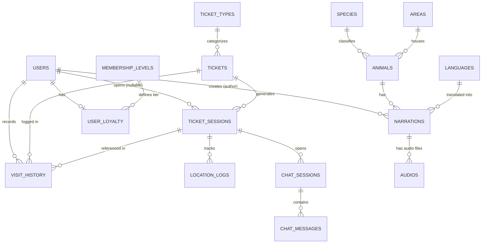

# ZooGuide Database Architecture & Specification
> **SINGLE SOURCE OF TRUTH (SSOT) FOR THE ENTIRE ZOOGUIDE DEVELOPMENT TEAM**

---

## 1. Overview & System Context
ZooGuide là nền tảng số hỗ trợ khách tham quan sở thú thông qua:
1. **Xác thực vé thông minh bằng mã QR/Barcode:** Khách quét vé để tạo phiên tham quan (`TicketSession`), mở khóa bản đồ số và thuyết minh tự động.
2. **Khách vãng lai (Anonymous) & Khách có tài khoản:** Khách tham quan không bắt buộc phải đăng ký tài khoản vẫn sử dụng được toàn bộ các tính năng tham quan. Khách có tài khoản được hưởng thêm tính năng xem lịch sử tham quan và tích điểm thành viên (`VisitHistory`, `UserLoyalty`).
3. **Thuyết minh tự động đa ngôn ngữ:** Mỗi cá thể động vật có các bài thuyết minh tương ứng với từng ngôn ngữ (`vi`, `en`, `zh`, `ja`...). File âm thanh được stream qua URL/path, không lưu binary trong cơ sở dữ liệu.
4. **Bản đồ số & Định vị GPS (Geofencing):** Tọa độ cố định và bán kính định vị thuộc về phân khu chuồng trại (`AREAS`), vị trí du khách được cập nhật theo phiên (`TICKET_SESSIONS`).

---

## 2. Entity-Relationship Diagram (ERD)



---

## 3. Data Dictionary & Table Descriptions

### 3.1. USERS
- **Mục đích:** Lưu trữ tài khoản người dùng có đăng ký (Visitor, Staff, Admin).
- **Quy tắc:**
  - Password lưu dưới dạng `PasswordHash` (SHA-256 / PBKDF2). Nghiêm cấm lưu plaintext password.
  - Phân quyền theo cột `Role` (`Visitor`, `Staff`, `Admin`). Không tách riêng bảng `Visitor` / `Staff`.
  - Khách vãng lai KHÔNG cần record trong bảng này.

| Cột | Kiểu dữ liệu | Ràng buộc | Mô tả |
| :--- | :--- | :--- | :--- |
| `UserId` | `INT` | PK, IDENTITY(1,1) | Mã định danh người dùng |
| `Username` | `NVARCHAR(50)` | NOT NULL, UNIQUE | Tên đăng nhập |
| `Email` | `NVARCHAR(100)` | NOT NULL, UNIQUE | Địa chỉ email liên hệ |
| `PasswordHash` | `NVARCHAR(256)` | NOT NULL | Chuỗi băm mật khẩu bảo mật |
| `FullName` | `NVARCHAR(100)` | NOT NULL | Họ và tên đầy đủ |
| `Role` | `NVARCHAR(20)` | NOT NULL, CHECK | `Visitor`, `Staff`, `Admin` |
| `Status` | `NVARCHAR(20)` | NOT NULL, CHECK | `Active`, `Locked` |
| `CreatedAt` | `DATETIME2` | NOT NULL, DEFAULT UTC | Thời điểm tạo tài khoản |
| `UpdatedAt` | `DATETIME2` | NULL | Thời điểm cập nhật |
| `LastLoginAt` | `DATETIME2` | NULL | Lần đăng nhập gần nhất |

---

### 3.2. TICKET_TYPES
- **Mục đích:** Danh mục các loại vé và chính sách bán vé của sở thú.

| Cột | Kiểu dữ liệu | Ràng buộc | Mô tả |
| :--- | :--- | :--- | :--- |
| `TicketTypeId` | `INT` | PK, IDENTITY(1,1) | Mã định danh loại vé |
| `Name` | `NVARCHAR(100)` | NOT NULL | Tên loại vé (Người lớn, Trẻ em, SV...) |
| `Description` | `NVARCHAR(500)` | NULL | Mô tả chi tiết quyền lợi vé |
| `Price` | `DECIMAL(18,2)` | NOT NULL, CHECK >= 0 | Giá vé niêm yết (VNĐ) |
| `DurationMinutes` | `INT` | NOT NULL, CHECK > 0 | Thời lượng hợp lệ tính theo phút (VD: 480 = 8h) |
| `IsActive` | `BIT` | NOT NULL, DEFAULT 1 | Trạng thái đang bán/tạm ngưng |
| `CreatedAt` | `DATETIME2` | NOT NULL, DEFAULT UTC | Ngày tạo |
| `UpdatedAt` | `DATETIME2` | NULL | Ngày cập nhật |

---

### 3.3. TICKETS
- **Mục đích:** Quản lý từng vé tham quan được phát hành.
- **Quy tắc:**
  - `TicketCode` là chuỗi UNIQUE được mã hóa thành QR Code hoặc Barcode trên vé giấy/vé điện tử.
  - Không lưu file ảnh QR vào database (client tự generate từ `TicketCode`).
  - Vé độc lập với tài khoản người dùng để khách không đăng nhập vẫn mua và quét vé bình thường.

| Cột | Kiểu dữ liệu | Ràng buộc | Mô tả |
| :--- | :--- | :--- | :--- |
| `TicketId` | `INT` | PK, IDENTITY(1,1) | Khóa chính vé |
| `TicketCode` | `NVARCHAR(50)` | NOT NULL, UNIQUE, INDEX | Mã vé hiển thị trên QR code |
| `TicketTypeId` | `INT` | FK -> `TICKET_TYPES`, INDEX | Khóa ngoại loại vé |
| `IssuedAt` | `DATETIME2` | NOT NULL, DEFAULT UTC | Thời điểm xuất vé |
| `ValidFrom` | `DATETIME2` | NOT NULL | Thời điểm bắt đầu có hiệu lực |
| `ValidUntil` | `DATETIME2` | NOT NULL | Thời điểm hết hạn |
| `Status` | `NVARCHAR(20)` | NOT NULL, CHECK, INDEX | `Valid`, `Used`, `Expired`, `Cancelled`, `Locked` |
| `UsedAt` | `DATETIME2` | NULL | Thời điểm quét sử dụng vé lần đầu |
| `CreatedAt` | `DATETIME2` | NOT NULL, DEFAULT UTC | Thời điểm tạo record |
| `UpdatedAt` | `DATETIME2` | NULL | Thời điểm sửa |

---

### 3.4. TICKET_SESSIONS
- **Mục đích:** Quản lý phiên tham quan thực tế trong ngày sau khi quét vé thành công.
- **Quy tắc then chốt:**
  - **Khách không đăng nhập:** `UserId` = `NULL`.
  - **Khách đã đăng nhập:** `UserId` = `UserId`.
  - `LastLatitude`, `LastLongitude`, `LastLocationAt` lưu vị trí GPS thời gian thực gần nhất của phiên này để phục vụ gợi ý chuồng thú gần nhất.

| Cột | Kiểu dữ liệu | Ràng buộc | Mô tả |
| :--- | :--- | :--- | :--- |
| `SessionId` | `UNIQUEIDENTIFIER` | PK, DEFAULT NEWID() | Mã định danh phiên (GUID bảo mật chống đoán) |
| `TicketId` | `INT` | FK -> `TICKETS`, INDEX | Mã vé sở hữu phiên |
| `UserId` | `INT` | FK -> `USERS` (NULL), INDEX | Người dùng liên kết (nếu đã đăng nhập) |
| `StartedAt` | `DATETIME2` | NOT NULL, DEFAULT UTC | Thời điểm bắt đầu phiên |
| `ExpiredAt` | `DATETIME2` | NOT NULL | Thời điểm phiên hết hạn |
| `EndedAt` | `DATETIME2` | NULL | Thời điểm kết thúc phiên (nếu khách chủ động thoát) |
| `Status` | `NVARCHAR(20)` | NOT NULL, CHECK, INDEX | `Active`, `Expired`, `Ended`, `Revoked` |
| `LastLatitude` | `DECIMAL(9,6)` | NULL | Tọa độ vĩ độ gần nhất của du khách |
| `LastLongitude` | `DECIMAL(9,6)` | NULL | Tọa độ kinh độ gần nhất của du khách |
| `LastLocationAt` | `DATETIME2` | NULL | Thời điểm ghi nhận tọa độ cuối |

---

### 3.5. SPECIES
- **Mục đích:** Danh mục phân loại loài sinh học.

| Cột | Kiểu dữ liệu | Ràng buộc | Mô tả |
| :--- | :--- | :--- | :--- |
| `SpeciesId` | `INT` | PK, IDENTITY(1,1) | Mã định danh loài |
| `Name` | `NVARCHAR(100)` | NOT NULL, UNIQUE | Tên loài (Sư tử Châu Phi, Hổ Bengal...) |
| `ScientificName` | `NVARCHAR(150)` | NULL | Tên khoa học La-tinh |
| `Description` | `NVARCHAR(1000)` | NULL | Mô tả đặc tính loài |
| `ConservationStatus` | `NVARCHAR(50)` | NULL | Tình trạng bảo tồn (CR, EN, VU, LC...) |
| `ImageUrl` | `NVARCHAR(500)` | NULL | Ảnh minh họa loài |
| `CreatedAt` | `DATETIME2` | NOT NULL, DEFAULT UTC | Ngày tạo |
| `UpdatedAt` | `DATETIME2` | NULL | Ngày cập nhật |

---

### 3.6. AREAS
- **Mục đích:** Lưu trữ thông tin phân khu chuồng trại trong sở thú.
- **Quy tắc Geofencing:**
  - `Latitude`, `Longitude`: Tọa độ tâm cố định của chuồng trại.
  - `RadiusMeters`: Bán kính phát hiện (mét). Khi khoảng cách giữa du khách và chuồng <= `RadiusMeters`, hệ thống tự động kích hoạt bài thuyết minh chuồng thú tương ứng.
  - Tuyệt đối không lưu GPS của du khách vào bảng này.

| Cột | Kiểu dữ liệu | Ràng buộc | Mô tả |
| :--- | :--- | :--- | :--- |
| `AreaId` | `INT` | PK, IDENTITY(1,1) | Mã khu vực chuồng trại |
| `Name` | `NVARCHAR(100)` | NOT NULL, UNIQUE | Tên khu vực (Khu Sư tử, Khu Voi...) |
| `Description` | `NVARCHAR(1000)` | NULL | Mô tả cảnh quan khu vực |
| `Latitude` | `DECIMAL(9,6)` | NOT NULL | Tọa độ vĩ độ trung tâm |
| `Longitude` | `DECIMAL(9,6)` | NOT NULL | Tọa độ kinh độ trung tâm |
| `RadiusMeters` | `DECIMAL(8,2)` | NOT NULL, CHECK > 0 | Bán kính kích hoạt Geofencing (mét) |
| `MapImageUrl` | `NVARCHAR(500)` | NULL | Đường dẫn file sơ đồ phân khu |
| `Status` | `NVARCHAR(20)` | NOT NULL, CHECK | `Active`, `Maintenance`, `Closed` |
| `CreatedAt` | `DATETIME2` | NOT NULL, DEFAULT UTC | Ngày tạo |
| `UpdatedAt` | `DATETIME2` | NULL | Ngày sửa |

---

### 3.7. ANIMALS
- **Mục đích:** Hồ sơ từng cá thể động vật trong sở thú.
- **Quy tắc:**
  - Tham chiếu đến `SpeciesId` và `AreaId`.
  - Không lưu trực tiếp văn bản thuyết minh hoặc file audio trong bảng này.

| Cột | Kiểu dữ liệu | Ràng buộc | Mô tả |
| :--- | :--- | :--- | :--- |
| `AnimalId` | `INT` | PK, IDENTITY(1,1) | Mã cá thể động vật |
| `SpeciesId` | `INT` | FK -> `SPECIES`, INDEX | Khóa ngoại loài |
| `AreaId` | `INT` | FK -> `AREAS`, INDEX | Khóa ngoại phân khu chuồng |
| `Name` | `NVARCHAR(100)` | NOT NULL | Tên riêng của con vật (Simba, Nala...) |
| `Description` | `NVARCHAR(1000)` | NULL | Đặc điểm ngoại hình, tính cách |
| `Gender` | `NVARCHAR(10)` | NOT NULL, CHECK | `Unknown`, `Male`, `Female` |
| `DateOfBirth` | `DATE` | NULL | Ngày sinh (nếu rõ) |
| `Origin` | `NVARCHAR(200)` | NULL | Nguồn gốc / Nơi cứu hộ |
| `HealthStatus` | `NVARCHAR(200)` | NULL | Tình trạng sức khỏe hiện tại |
| `ConservationNote` | `NVARCHAR(500)` | NULL | Ghi chú chương trình bảo tồn giống |
| `ImageUrl` | `NVARCHAR(500)` | NULL | Ảnh chụp thực tế của cá thể |
| `Status` | `NVARCHAR(20)` | NOT NULL, CHECK, INDEX | `Active`, `UnderTreatment`, `Transferred`, `Deceased` |
| `CreatedAt` | `DATETIME2` | NOT NULL, DEFAULT UTC | Ngày tạo |
| `UpdatedAt` | `DATETIME2` | NULL | Ngày sửa |

---

### 3.8. LANGUAGES
- **Mục đích:** Danh mục ngôn ngữ thuyết minh được hệ thống hỗ trợ.

| Cột | Kiểu dữ liệu | Ràng buộc | Mô tả |
| :--- | :--- | :--- | :--- |
| `LanguageId` | `INT` | PK, IDENTITY(1,1) | Mã định danh ngôn ngữ |
| `Code` | `NVARCHAR(10)` | NOT NULL, UNIQUE | Mã ngôn ngữ tiêu chuẩn (`vi`, `en`, `zh`, `ja`...) |
| `Name` | `NVARCHAR(50)` | NOT NULL | Tên hiển thị (Tiếng Việt, English...) |
| `IsActive` | `BIT` | NOT NULL, DEFAULT 1 | Cho phép du khách chọn hay không |
| `CreatedAt` | `DATETIME2` | NOT NULL, DEFAULT UTC | Ngày tạo |
| `UpdatedAt` | `DATETIME2` | NULL | Ngày sửa |

---

### 3.9. NARRATIONS
- **Mục đích:** Nội dung thuyết minh đa ngôn ngữ cho từng con vật.
- **Ràng buộc:**
  - `UQ_Narrations_Animal_Language`: `UNIQUE(AnimalId, LanguageId)` đảm bảo mỗi con vật chỉ có đúng một bài thuyết minh chính thức cho một ngôn ngữ.
  - `CreatedBy` tham chiếu `USERS` để biết nhân viên nào biên soạn.

| Cột | Kiểu dữ liệu | Ràng buộc | Mô tả |
| :--- | :--- | :--- | :--- |
| `NarrationId` | `INT` | PK, IDENTITY(1,1) | Khóa chính bài thuyết minh |
| `AnimalId` | `INT` | FK -> `ANIMALS` (Cascade) | Động vật được thuyết minh |
| `LanguageId` | `INT` | FK -> `LANGUAGES` (Restrict), INDEX | Ngôn ngữ bài thuyết minh |
| `Title` | `NVARCHAR(200)` | NOT NULL | Tiêu đề bài thuyết minh |
| `Content` | `NVARCHAR(MAX)` | NOT NULL | Toàn văn nội dung thuyết minh |
| `AudioUrl` | `NVARCHAR(500)` | NULL | Đường dẫn phát âm thanh mặc định |
| `DurationSeconds` | `INT` | NULL | Thời lượng phát âm thanh (giây) |
| `Status` | `NVARCHAR(20)` | NOT NULL, CHECK | `Draft`, `Published`, `Archived` |
| `CreatedBy` | `INT` | FK -> `USERS` (Restrict), INDEX | Nhân viên/Admin biên tập |
| `CreatedAt` | `DATETIME2` | NOT NULL, DEFAULT UTC | Ngày tạo |
| `UpdatedAt` | `DATETIME2` | NULL | Ngày cập nhật |

---

### 3.10. AUDIOS
- **Mục đích:** Danh sách các file âm thanh thu âm tương ứng với bài thuyết minh.
- **Quy tắc:**
  - Tuyệt đối không lưu file nhị phân trong SQL Server; chỉ lưu file URL/storage path, MIME type, dung lượng, thời lượng.
  - Quan hệ 1 Narration -> N Audios cho phép mở rộng hỗ trợ nhiều chất lượng, giọng đọc (Nam/Nữ) hoặc định dạng khác nhau.

| Cột | Kiểu dữ liệu | Ràng buộc | Mô tả |
| :--- | :--- | :--- | :--- |
| `AudioId` | `INT` | PK, IDENTITY(1,1) | Mã định danh file âm thanh |
| `NarrationId` | `INT` | FK -> `NARRATIONS` (Cascade), INDEX | Bài thuyết minh tương ứng |
| `FileUrl` | `NVARCHAR(500)` | NOT NULL | URL/Đường dẫn file âm thanh |
| `FileName` | `NVARCHAR(255)` | NOT NULL | Tên file gốc |
| `MimeType` | `NVARCHAR(100)` | NOT NULL, DEFAULT 'audio/mpeg' | Định dạng MIME (`audio/mpeg`, `audio/aac`...) |
| `DurationSeconds` | `INT` | NULL | Thời lượng phát (giây) |
| `FileSize` | `BIGINT` | NULL | Dung lượng file tính bằng bytes |
| `Status` | `NVARCHAR(20)` | NOT NULL, CHECK | `Active`, `Inactive`, `Processing` |
| `CreatedAt` | `DATETIME2` | NOT NULL, DEFAULT UTC | Ngày upload |
| `UpdatedAt` | `DATETIME2` | NULL | Ngày cập nhật |

---

### 3.11. VISIT_HISTORY
- **Mục đích:** Ghi nhận lịch sử các chuyến tham quan của du khách có tài khoản.
- **Quy tắc:** Chỉ được insert khi `UserId` hợp lệ (khách đã đăng nhập).

| Cột | Kiểu dữ liệu | Ràng buộc | Mô tả |
| :--- | :--- | :--- | :--- |
| `VisitId` | `INT` | PK, IDENTITY(1,1) | Mã bản ghi lịch sử |
| `UserId` | `INT` | FK -> `USERS` (Restrict), INDEX | Người dùng tham quan |
| `TicketId` | `INT` | FK -> `TICKETS` (Restrict), INDEX | Vé sử dụng |
| `SessionId` | `UNIQUEIDENTIFIER` | FK -> `TICKET_SESSIONS`, INDEX | Phiên tham quan |
| `VisitedAt` | `DATETIME2` | NOT NULL, DEFAULT UTC | Thời điểm tham quan |

---

### 3.12. LOCATION_LOGS (Mở rộng GPS)
- **Mục đích:** Ghi nhận nhật ký di chuyển của phiên tham quan phục vụ thống kê lộ trình và tối ưu luồng tham quan.
- **Quy tắc:** Liên kết với `SessionId`. Không lưu `UserId` trực tiếp để bảo vệ quyền riêng tư. Có Composite Index `(SessionId, RecordedAt)`.

| Cột | Kiểu dữ liệu | Ràng buộc | Mô tả |
| :--- | :--- | :--- | :--- |
| `LocationLogId` | `BIGINT` | PK, IDENTITY(1,1) | Mã định danh log |
| `SessionId` | `UNIQUEIDENTIFIER` | FK -> `TICKET_SESSIONS` (Cascade) | Phiên tham quan tương ứng |
| `Latitude` | `DECIMAL(9,6)` | NOT NULL | Tọa độ vĩ độ |
| `Longitude` | `DECIMAL(9,6)` | NOT NULL | Tọa độ kinh độ |
| `Accuracy` | `DECIMAL(6,2)` | NULL | Sai số GPS tính bằng mét |
| `RecordedAt` | `DATETIME2` | NOT NULL, DEFAULT UTC | Thời điểm ghi nhận |

---

### 3.13. MEMBERSHIP_LEVELS & USER_LOYALTY (Mở rộng Tích điểm)
- `MEMBERSHIP_LEVELS`: Các hạng thành viên (Đồng, Bạc, Vàng, Kim Cương).
- `USER_LOYALTY`: Bảng quan hệ 1-1 với `USERS` (`UserId` vừa là PK vừa là FK).

---

### 3.14. CHAT_SESSIONS & CHAT_MESSAGES (Mở rộng Trợ lý ảo Chatbot)
- `CHAT_SESSIONS`: Phiên hỏi đáp chatbot gắn liền với `TicketSession`.
- `CHAT_MESSAGES`: Lịch sử từng tin nhắn giữa du khách (`Visitor`), trợ lý ảo (`Bot`), hoặc hỗ trợ viên (`Staff`).

---

## 4. Design Decisions & Architectural FAQ

### Q1: Vì sao cần bảng `TICKET_SESSIONS` và vì sao `UserId` lại Nullable?
- **Nguyên nhân:** Mô hình nghiệp vụ thực tế của sở thú là bán vé trực tiếp cho khách vãng lai (Anonymous). Khách chỉ cần quét mã QR trên vé giấy là có thể kích hoạt web app và nghe thuyết minh ngay lập tức mà không bị cản trở bởi thủ tục tạo tài khoản.
- Do đó:
  - Nếu khách **chưa đăng nhập**: Backend tạo `TicketSession` với `TicketId = X` và `UserId = NULL`.
  - Nếu khách **đã đăng nhập** (hoặc đăng nhập sau khi vào web): Backend liên kết `UserId = Y` vào `TicketSession`.
- **Lợi ích:** Đảm bảo bảo mật (mỗi vé kiểm soát được số phiên truy cập đồng thời), đồng thời tối ưu trải nghiệm khách hàng tối đa (Zero-friction onboarding).

### Q2: Vì sao tọa độ GPS thuộc về `AREAS` mà không thuộc về `ANIMALS`?
- **Nguyên nhân:** Động vật sinh sống trong các phân khu/chuồng trại (`AREAS`). Bản thân con vật di chuyển trong chuồng chứ không có tọa độ GPS độc lập cố định.
- Tọa độ chuồng trại (`Latitude`, `Longitude`, `RadiusMeters`) là thông số vật lý cố định của sở thú, giúp giải thuật Geofencing ở client/backend tính toán cự ly du khách tiếp cận chuồng.

### Q3: Vì sao tách riêng `NARRATIONS`, `LANGUAGES` và `AUDIOS`?
- Đề tài là **Thuyết minh tự động đa ngôn ngữ**.
- Tách `LANGUAGES`: Đảm bảo chuẩn hóa mã ngôn ngữ quốc tế (`vi`, `en`, `zh`, `ja`...) mà không lặp text tên ngôn ngữ.
- Tách `NARRATIONS`: Một con vật có thể có nhiều bài thuyết minh theo các thứ tiếng khác nhau.
- Tách `AUDIOS`: Một bài thuyết minh có thể có nhiều phiên bản thu âm (giọng đọc nam, giọng đọc nữ, bản chất lượng cao, định dạng nén tiết kiệm băng thông di động).

### Q4: Vì sao KHÔNG lưu file audio binary vào SQL Server?
- File âm thanh MP3/AAC thường có dung lượng từ 1MB đến 10MB.
- Lưu binary (BLOB/VARBINARY(MAX)) trong SQL Server sẽ làm phình to dung lượng database, gây chậm backup/restore, tốn I/O buffer pool và không thể tận dụng cơ chế CDN/HTTP Range requests để tua âm thanh.
- SQL Server chỉ lưu URL và Metadata; file thực tế được lưu trên Web Server static storage, AWS S3 hoặc Azure Blob Storage.

---

## 5. Quy Ước Đặt Tên & Coding Standard
1. **Bảng cơ sở dữ liệu:** Viết hoa toàn bộ, dùng số nhiều hoặc danh từ phân cách bởi dấu gạch dưới (`USERS`, `TICKETS`, `TICKET_SESSIONS`, `AREAS`, `ANIMALS`).
2. **Khóa chính:** `[TableName]Id` dạng PascalCase (`UserId`, `TicketId`, `SessionId`).
3. **Khóa ngoại:** Trỏ chính xác tới tên PK của bảng cha (`TicketTypeId`, `SpeciesId`, `AreaId`).
4. **Kiểu dữ liệu tiền tệ:** `DECIMAL(18,2)`.
5. **Kiểu dữ liệu tọa độ:** `DECIMAL(9,6)` (độ chính xác đến 10cm trên thực địa).
6. **Thời gian:** Toàn bộ lưu `DATETIME2` theo chuẩn `UTC` (`GETUTCDATE()`).
7. **Enum conversion:** Lưu chuỗi `NVARCHAR(20)` có CHECK constraint ở database, map sang `enum` tương ứng trong C# Domain.

---

## 6. Hướng Dẫn Thực Thi (Deployment & Development)

### 6.1. Chạy bằng SQL Script chính thức
File SQL tự động tạo database, drop bảng cũ an toàn, tạo mới 16 bảng và nạp sẵn mock data kiểm thử:
```powershell
sqlcmd -S . -E -i "database\ZooGuide_Database.sql"
```

### 6.2. Chạy bằng Entity Framework Core Migration
Cập nhật database tự động từ code C# và Migrations:
```powershell
# Chuyển vào thư mục ZooGuide
cd "C:\Users\admin\Desktop\Study\Công nghệ phần mềm\ZooGuide"

# Cập nhật database
dotnet ef database update --project src/Infrastructure/ZooGuide.Infrastructure.csproj --startup-project src/API/ZooGuide.API.csproj
```

### 6.3. Khởi chạy Backend API
```powershell
dotnet run --project src/API/ZooGuide.API.csproj
```
- Khi chạy ở môi trường Development, API sẽ tự động kích hoạt `ZooGuideDataSeeder.SeedAsync` nếu cơ sở dữ liệu chưa có dữ liệu.
- Swagger UI sẵn sàng tại: `http://localhost:5000/swagger` (hoặc cổng cấu hình).
- Health check kiểm tra kết nối DB: `GET http://localhost:5000/api/health`.

---

## 7. SOURCE OF TRUTH CONTRACT (BẮT BUỘC TUÂN THỦ)
> **Kể từ thời điểm này, Schema trong file `ZooGuide_Database.sql`, DbContext và file `DATABASE.md` này là HỢP ĐỒNG DUY NHẤT (Single Source of Truth) của toàn bộ project.**

Tất cả thành viên trong nhóm:
- ❌ **KHÔNG** tự ý đổi tên bảng, đổi tên cột, đổi kiểu dữ liệu.
- ❌ **KHÔNG** tạo bảng `Visitor` riêng biệt (dùng `USERS` với `Role = 'Visitor'`).
- ❌ **KHÔNG** lưu tọa độ GPS vào `ANIMALS` (chỉ lưu vào `AREAS`).
- ❌ **KHÔNG** lưu nội dung thuyết minh trực tiếp vào `ANIMALS` (dùng `NARRATIONS`).
- ❌ **KHÔNG** lưu mật khẩu dạng plaintext (bắt buộc dùng `PasswordHash`).
- ❌ **KHÔNG** lưu file audio binary trực tiếp vào SQL Server.
- ✅ Khi cần thay đổi schema: Phải tạo proposal thảo luận với team, cập nhật file `ZooGuide_Database.sql`, cập nhật Domain Entities & Fluent Configurations, tạo Migration mới và cập nhật `DATABASE.md`.
